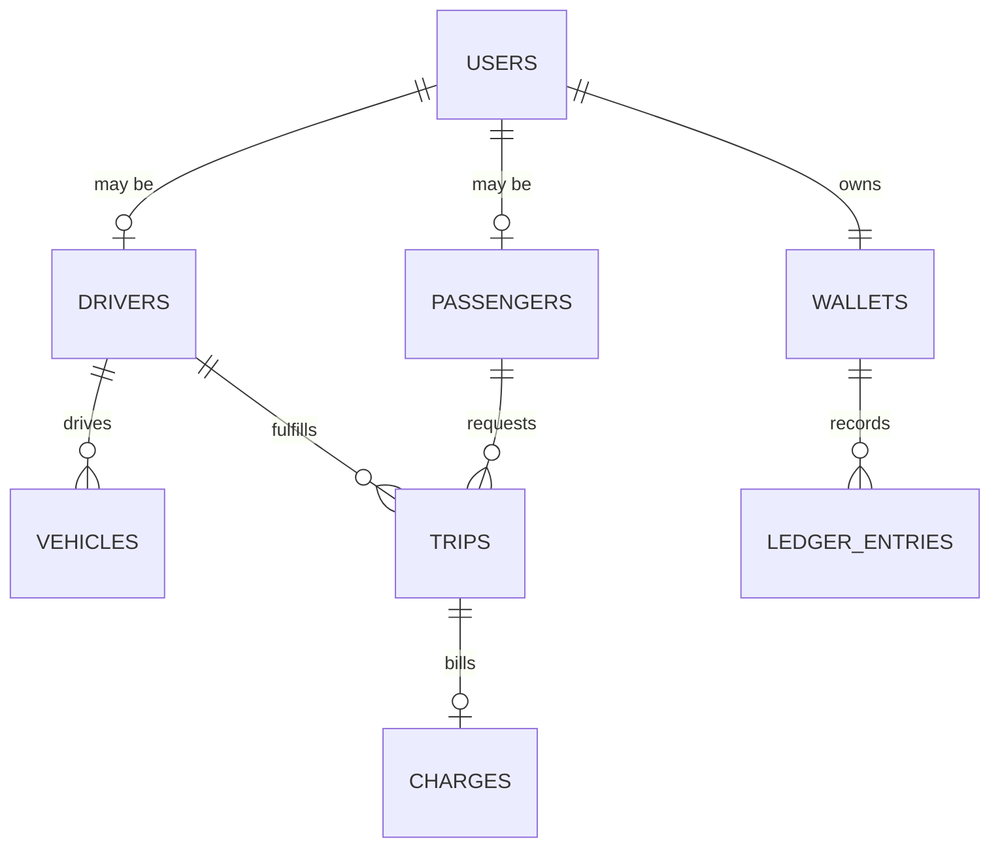

# Data Model Diagram

> Placeholder. Once core domains (trips, drivers, passengers, payments,
> wallet) have real Firestore collections, replace this with an entity
> relationship diagram, e.g.:

This is illustrative only — no collections currently exist. Update this
diagram alongside [firestore-schema.md](firestore-schema.md) as each
domain's data model is finalized.
