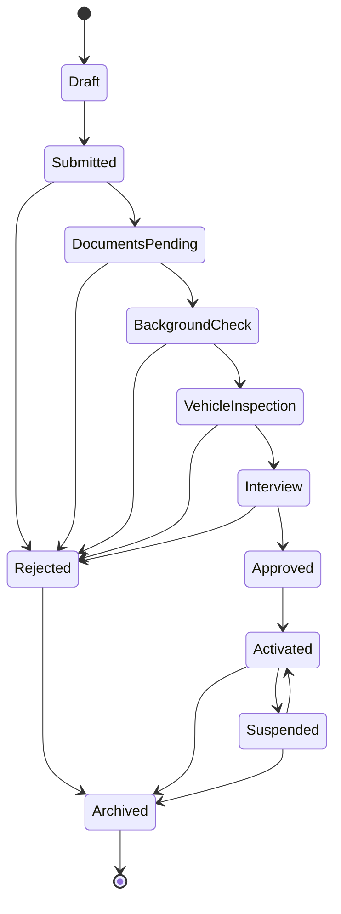

# Driver Management

## Recruitment pipeline

`DriverApplicationStatus` (`packages/types/src/drivers/drivers.enums.ts`).
The only place allowed to decide whether a transition is legal is
`packages/utils/src/drivers/workflow.ts`, driven by the
`DRIVER_APPLICATION_TRANSITIONS` map in `drivers.constants.ts`.



Activation is the pipeline's hand-off point: transitioning an application to
`Activated` (`DriversRepository.activateApplication`) is what creates the
`drivers` collection document — before that point, there is no driver
account, only an application.

`DriverAccountStatus` (`active` / `suspended` / `terminated`) is a
**separate**, simpler state machine for the driver account itself, once
activated. It isn't in the transitions map above — its three simple rules
(suspend requires active, reactivate requires suspended, terminate is
allowed from either and is final) are checked inline in
`DriversRepository`.

## Services

All of the following live in
`packages/firebase/src/firestore/drivers.repository.ts` as methods on
`DriversRepository`, not as a separate "service" layer — see
[architecture-sprint1.md](./architecture-sprint1.md) for why. Every method
validates its precondition, writes the change, and records an audit log in
one call.

| Service | Method | Precondition | Audit action |
| --- | --- | --- | --- |
| Approve Driver | `approveApplication()` | application at `Interview` | `driver.approved` |
| Reject Driver | `rejectApplication(reason)` | application not already terminal | `driver.rejected` |
| Activate Driver | `activateApplication()` | application at `Approved`; creates the `drivers` doc | `driver.activated` |
| Suspend Driver | `suspend(reason, endAt?)` | driver `active` | `driver.suspended` |
| Reactivate Driver | `reactivate()` | driver `suspended`; lifts open suspensions | `driver.reactivated` |
| Warn Driver | `warn(reason)` | driver exists; recalculates score | `driver.warned` |
| Terminate Driver | `terminate(reason)` | driver not already `terminated` | `driver.terminated` |
| Driver Status | `getStatus(driverId)` | — | — |
| Driver Statistics | `getStatistics(driverId)` | — | — |

`DriverStatistics` is currently derived from the driver's own denormalized
counters (`completedTrips`, `rating`, `warningsCount`, `score`);
`cancelledTrips` and `totalEarnings` default to 0 until the `trips` and
`payments` domains have real aggregation logic (out of scope this sprint).

### Document expiration

`packages/utils/src/drivers/document-expiration.ts` classifies a driver
document (`DriverDocument.expiresAt`) as `expired`, `expiring_soon` (within
`DOCUMENT_EXPIRATION_WARNING_DAYS`, default 14), `valid`, or
`no_expiration`. `getExpiringDocuments()` filters a driver's document list
down to the ones needing attention — intended to back a future "documents
expiring soon" admin report.

### Driver score

`packages/utils/src/drivers/score.ts`. Deterministic, explainable 0-100
score, recalculated whenever a warning is issued:

```
score = 100
        - (5 - rating) × 10       // rating penalty, 0-50
        - warningsCount × 5       // warning penalty
        - cancellationRate × 20   // cancelled / (completed + cancelled), 0-20
clamped to [0, 100]
```

## Related Docs

- [Authentication](./authentication.md)
- [RBAC](./rbac.md)
- [Firestore Schema](./firestore-schema.md)
- [Security](./security.md)
