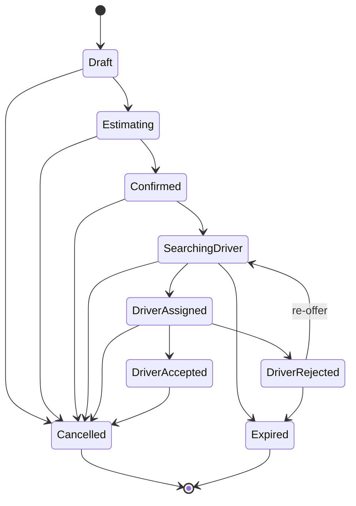

# Ride Request Engine

Sprint 3's core feature: a passenger can request a ride end-to-end (choose
locations, pick a vehicle, see a fare estimate, confirm) and the backend
has a real state machine and dispatch algorithm behind it. No trip
execution, live tracking, or payment capture yet — those are later
sprints.

## Scope note

The passenger app's booking flow (`apps/passenger-app/src/app/booking/`)
is a fully working **client-side** flow backed by real logic (the pricing
engine, the map provider abstraction) but does **not** yet write to
Firestore. Sprint 1/2 never wired a real authenticated session into any
client app (`apps/admin`'s dashboard uses a placeholder auth context; the
passenger app has no login-to-session wiring either) — so there's no real
`passengerId` to attach a `tripRequests` document to yet. The backend side
of the engine (`TripRequestsRepository`, `DispatchService` in
`@the-ride/firebase`) is fully built and tested against the real Zod
schemas; wiring the passenger app to call it is a natural next step once
a real session exists.

## Booking flow

```
┌──────────────┐     ┌──────────────────┐     ┌─────────────────┐     ┌─────────┐     ┌───────────┐
│ Booking      │ --> │ Location Search  │ --> │ Vehicle          │ --> │ Confirm │ --> │ Searching │
│ (pickup/     │     │ (reused for      │     │ Selection        │     │ Booking │     │ Driver    │
│  destination/│     │  pickup/dest/    │     │ (route + fare    │     │         │     │ (cancel   │
│  stops)      │     │  stop)           │     │  per category)   │     │         │     │  here too)│
└──────────────┘     └──────────────────┘     └─────────────────┘     └─────────┘     └───────────┘
```

One `location-search.tsx` screen serves pickup, destination, *and* stop
selection via a `target` route param, rather than three near-identical
screens — see docs/ui-architecture.md's "no duplicated code" principle.

## Ride request lifecycle

`TripRequestStatus` (`packages/types/src/trips/trips.enums.ts`), enforced
by `packages/utils/src/trips/workflow.ts` (same pattern as Sprint 1's
driver-application workflow):



`Pending`/`Matched` (Sprint 1's original, smaller status set) still exist
on the enum and have simple transitions defined, but nothing in this
sprint uses them — new code should use `SearchingDriver`/`DriverAssigned`
instead. They weren't removed because nothing in `packages/types` is
allowed to be a breaking change this sprint (see the repo-wide "do not
refactor" rule); see docs/architecture-sprint1.md for the precedent
(additive-only schema evolution).

## Repository methods (`@the-ride/firebase`'s `TripRequestsRepository`)

| Method | Transition | Notes |
| --- | --- | --- |
| `createDraft()` | `[*]` -> `draft` | Part 1: pickup/destination/stops chosen |
| `setEstimate()` | `draft` -> `estimating` | Vehicle category + route + fare computed |
| `confirm()` | `estimating` -> `confirmed` | Stamps `expiresAt` |
| `startSearching()` | `confirmed`/`driver_rejected` -> `searching_driver` | Called by `DispatchService` |
| `assignDriver()` | `searching_driver` -> `driver_assigned` | Stamps `driverResponseDeadline` |
| `driverAccept()` | `driver_assigned` -> `driver_accepted` | Trip execution is out of scope |
| `driverReject()` | `driver_assigned` -> `driver_rejected` | Clears the prior assignment via `FieldValue.delete()` |
| `cancel()` | any non-terminal -> `cancelled` | Part 1: "Cancel booking before assignment" is the common case, not the only legal one |
| `expire()` | `searching_driver`/`driver_rejected` -> `expired` | No driver accepted in time |

## Firestore changes

- `tripRequests` (Sprint 1 collection) — extended with `stops`,
  `vehicleCategoryId`, `estimatedDistanceMeters`, `estimatedDurationSeconds`,
  `fareEstimate`, `offeredDriverIds`, `assignedDriverId`,
  `driverResponseDeadline`, `cancelledAt`, `cancellationReason`,
  `updatedAt`. Every new field is optional/defaulted — Sprint 1's original
  (smaller) documents still validate unchanged.
- `drivers` (Sprint 1 collection) — extended with `isOnline`,
  `isAvailable`, `lastKnownLocation`, `lastLocationUpdatedAt` for dispatch
  eligibility (see docs/dispatch-engine.md).
- `vehicleCategories` (new collection) — see docs/vehicle-categories.md.
- `settings` (Sprint 1 singleton) — extended with ride-request config; see
  docs/pricing-engine.md and docs/dispatch-engine.md.

## Related Docs

- [Pricing Engine](./pricing-engine.md)
- [Dispatch Engine](./dispatch-engine.md)
- [Vehicle Categories](./vehicle-categories.md)
- [Maps](./maps.md)
- [Architecture (Sprint 1)](./architecture-sprint1.md)
